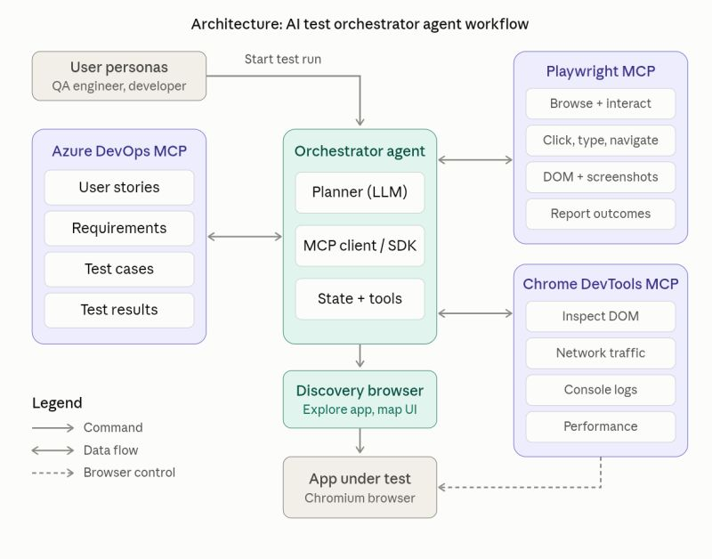

# Test Orchestrator

An AI-assisted workflow for validating Azure DevOps user stories against QA-authored test cases. The orchestrator coordinates source analysis, browser discovery, Playwright test generation and execution, evidence collection, and independent validation.

## What it does

For a configured story and target application, the workflow:

1. Retrieves the Azure DevOps story and associated QA test cases.
2. Analyzes relevant application source and checks reusable application knowledge.
3. Discovers runtime UI behavior when existing knowledge is missing or stale.
4. Generates TypeScript Playwright tests that preserve QA-authored expectations.
5. Executes the tests and captures evidence.
6. Independently evaluates the results against the QA expectations and evidence.

The workflow does not invent requirements or test results. Missing prerequisites, unclear expectations, or unavailable evidence can block validation.

## Repository contents

- `.copilot/agents/` — orchestrator and specialist agent definitions.
- `.copilot/skills/` — skills for retrieving stories and maintaining application knowledge.
- `.copilot/.test-automation/` — shared workflow, agent, tool, gate, and context guidance.
- `mcp-config.json` — Azure DevOps and Playwright MCP server configuration.

## Prerequisites

- GitHub Copilot agent support for the repository’s agent and skill definitions.
- An approved Azure DevOps MCP integration with access to the project’s stories and test cases.
- Playwright MCP for browser discovery and test execution.
- A target application and repository with the dependencies and Playwright configuration needed to run generated tests.
- `TEST_AUTOMATION_USERNAME` and `TEST_AUTOMATION_PASSWORD` set when the target application requires authentication.

Do not put credentials in prompts, generated tests, artifacts, screenshots, logs, or committed configuration. If required credentials are unavailable, authentication-dependent runs should stop as **BLOCKED**.

## Configuration

Before running the workflow:

1. Configure the Azure DevOps organization and project in the agent configuration.
2. Set up `mcp-config.json` for your approved Azure DevOps and Playwright MCP integrations. Replace its example organization and token placeholders, and keep real credentials out of version control.
3. Confirm the target project has the Playwright dependencies and configuration required to execute generated tests.
4. Set the required authentication environment variables securely, if applicable.

MCP tool capabilities depend on the configured servers. The workflow should use the capabilities those servers expose rather than assuming specific tool names.

## Running a validation

Invoke the `Test-Orchestrator` agent with:

- **Story ID** — the Azure DevOps story to validate.
- **Application URL** — the target application address.
- **Environment** — `DEV`, `QA`, or `UAT`.



Example:

```text
/Test-Orchestrator
story-id: 12345
url: https://your-application.example
environment: QA
